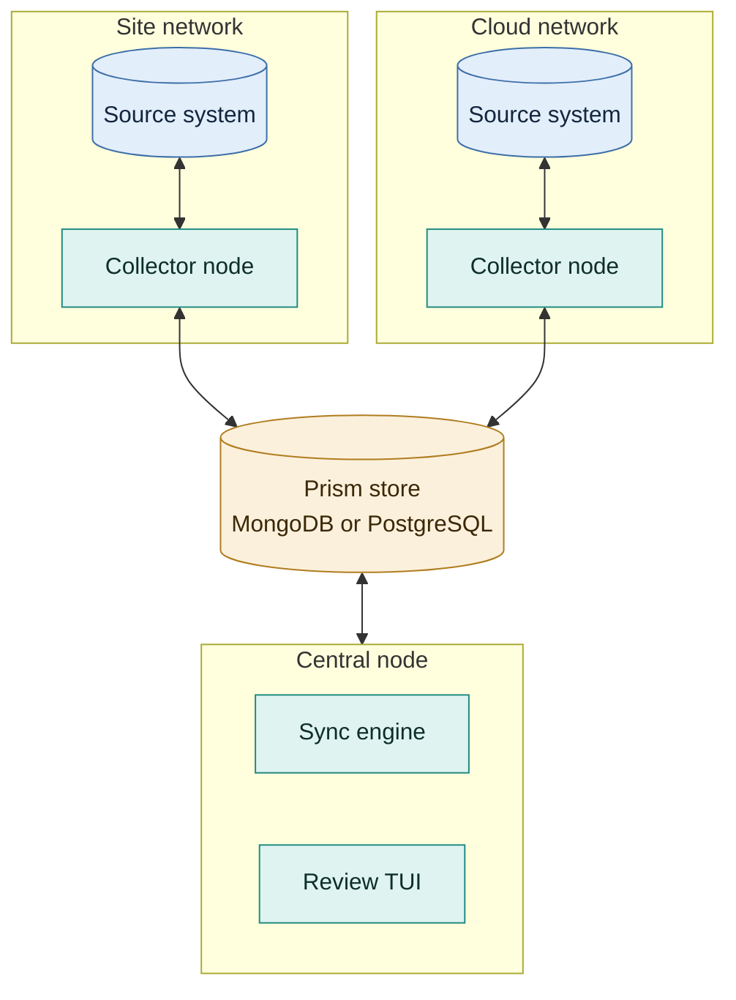
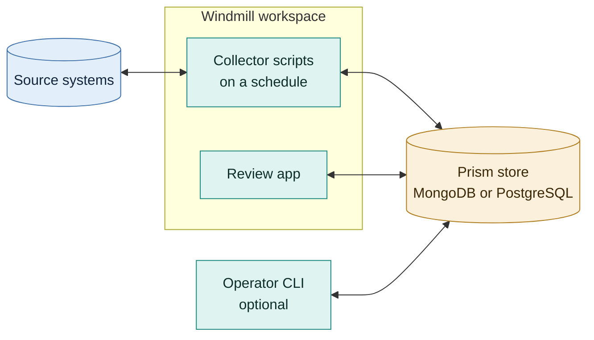

Sightline Prism is one product with two hostings. The hostings differ in where Prism runs and which interface the operator uses. They do not differ in what Prism does.

| Hosting | Where it runs | What the operator uses |
|---|---|---|
| Standalone Prism | Your own machines, as one or more nodes | The operator CLI, in a terminal |
| Windmill-hosted Prism | A Windmill workspace | The review app, in a browser |

Both hostings run the same engine, the same connectors and the same rules. A decision that an operator records in one has the same effect in the other.

## Two kinds of work, in two places

Prism splits its work by what each part must reach.

| Work | Where it runs | Why |
|---|---|---|
| Collect from a source | Near the source | Only a machine that can reach the source can read it. |
| Drain an outbox, which performs write-backs | Near the source | The write needs the same connectivity and credentials as the collection. |
| Match, merge and review | Centrally | The engine needs every connected dataset and the consolidated dataset. |

The two kinds of work meet in the Prism store. A collector writes its snapshot to the store. The engine reads the snapshot from the store and writes its write-backs to the outbox in the store.

## Standalone Prism

A standalone deployment is usually more than one node. The installer's `--role` flag chooses what each node does.

| Role | What the node does |
|---|---|
| `collector` | Collects from the sources it can reach |
| `central` | Runs the sync engine, the review TUI and the other operator CLI commands |
| `both` | Does both, on one machine |

The drain command, `prism-drain`, is part of the operator CLI. Run it on a machine that can reach the source it writes to.

Each node is a [runtime instance](/docs/prism/install/runtime-instance): a directory that holds that node's environment file, connector manifests and rules. Operational commands run from the runtime instance.

A single machine with the `both` role is enough for a trial. The local JSON store suits that case, because it needs no database server.

## Windmill-hosted Prism

Windmill-hosted Prism deploys the collectors as scheduled Windmill scripts, and serves the review app in a browser.

The review app records the same decisions as the review TUI. Both also cover a source that no connector can reach:

- A person uploads data for a source whose connector cannot run.
- A person completes a queued write-back by hand.

[The review app](/docs/prism/usage/review-app) describes both in the browser.

## The hostings are not exclusive

The operator CLI reads and writes an ordinary Prism store, and a Windmill-hosted store is an ordinary Prism store. An operator can run a CLI command against a Windmill-hosted deployment from a laptop, and the workspace shows the result.

Choose a hosting for where your operators work.

## Choose a storage backend

Prism stores its data in one of three backends.

| Backend | Use it for |
|---|---|
| MongoDB | Any deployment, and either hosting |
| PostgreSQL | Any deployment, and either hosting |
| Local JSON store | One operator on one machine. Windmill-hosted Prism does not support it. |

The backends do not share data. Choose the backend before you collect data that you want to keep. [Storage backends](/docs/prism/install/storage-backends) gives the settings for each one.

## What a release contains

Corvis supplies each hosting as one archive. The archive holds compiled code for the engine, the connectors and the interface. An install needs no source checkout, and it reaches no package registry.

## Where to go next

| Task | Document |
|---|---|
| Install Standalone Prism | [Installing Standalone Prism](/docs/prism/install/prism) |
| Install Windmill-hosted Prism | [Installing Windmill-hosted Prism](/docs/prism/install/windmill) |
| Learn what the operator CLI contains | [The operator CLI](/docs/prism/architecture/cli) |
| Learn what Windmill hosting adds | [Windmill-hosted Prism](/docs/prism/architecture/windmill) |
