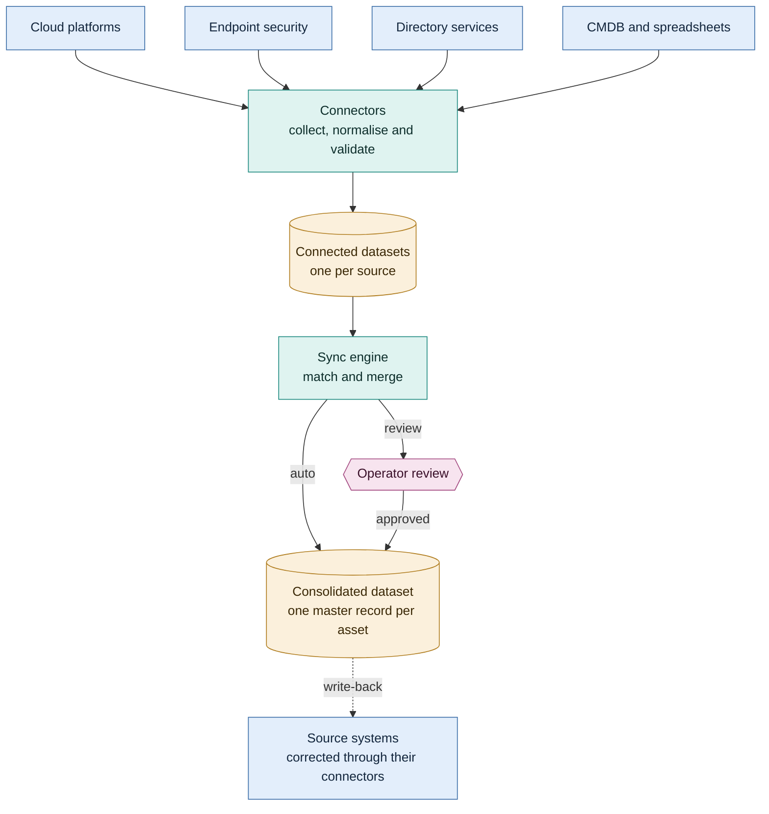

Sightline Prism keeps one current, auditable record of every asset in an estate. It collects asset data from the systems that already hold it. It matches the records that describe the same asset, and merges them into a consolidated dataset. Every value in that dataset records the source that supplied it and the reason it won.

## What Prism does

| Stage | What happens |
|---|---|
| Collect | A connector reads one source, normalises each record to a Prism schema, and stores a snapshot. |
| Match | The sync engine decides which records from different sources describe the same asset. |
| Merge | The engine compares each field with the value it already holds. Where the values differ, the source with the higher priority for that field wins. |
| Review | A change that a rule marks for review waits for an operator to approve, reject or decline it. |
| Write back | A reverse rule sends a merged value back to a source system, such as a CMDB. |

## What Prism guarantees

- **Provenance on every field.** Each value in the consolidated dataset records its source, that source's priority and the time it changed.
- **No silent new assets.** By default, a record that matches no existing asset waits for an operator to approve it.
- **Sources are read during a sync.** A sync reads stored snapshots. Only a write-back writes to a source, and the connector at that source performs it.
- **Snapshots are kept unchanged.** Each collection stays available for audit after later collections arrive.

## Ways to run Prism

Prism is one product with two hostings. Standalone Prism runs on your own machines, and an operator uses the operator CLI in a terminal. Windmill-hosted Prism runs in a Windmill workspace, and an operator uses the review app in a browser. Both run the same engine, connectors and rules. See [Deployment options](/docs/prism/architecture/deployment-options).

## Where Prism fits in Sightline

Sightline's [Tetra, Lamina and Metron](https://docs.corvis.au/docs/sightline/architecture/overview) models describe an architecture, its risks and its compliance. Those models are as accurate as the asset data behind them. Prism maintains that asset data from the systems that hold it, so it stays current after the first import.

## Where to go next

- [The asset data problem](/docs/prism/methodology/asset-data-problem)
- [How Prism works](/docs/prism/methodology/how-prism-works)
- [Install Standalone Prism](/docs/prism/install/prism)
- [First run](/docs/prism/usage/quickstart)
