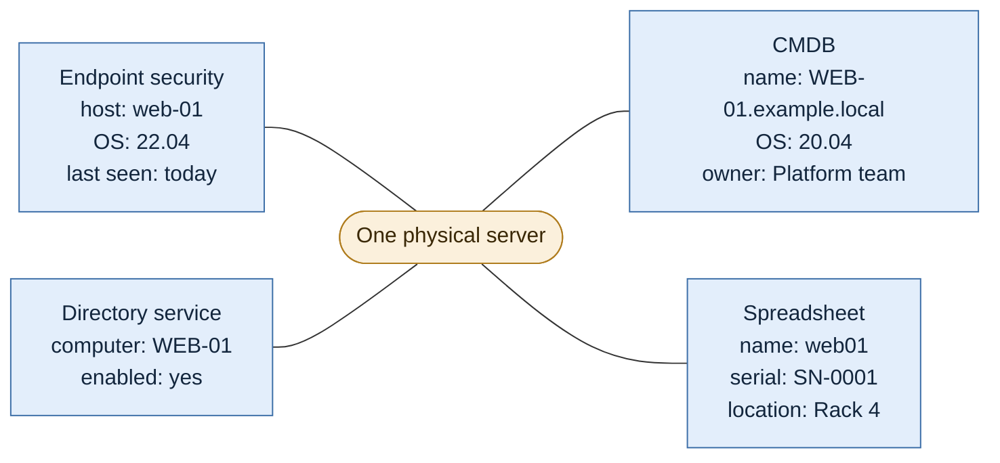

An organisation's asset inventory is spread across the systems that manage its assets. Each system holds the part of the picture that its own job needs. No system holds all of it, and the parts disagree.

## Each source sees part of the estate

| Kind of source | What it knows well | What it misses |
|---|---|---|
| Cloud platform | Instance size, image, network placement and power state | Assets outside that cloud, and the business owner |
| Endpoint security agent | Host name, operating system, agent health and the last time it saw the host | Devices that cannot run an agent, such as network and control equipment |
| Directory service | Computer accounts and where they sit in the directory | Hardware detail, and assets that are not joined to the domain |
| CMDB or asset register | Owner, cost centre, criticality and lifecycle state | Technical detail as it changes, because a person updates it |
| Spreadsheet | What one team recorded, often the only record of operational technology | Currency, because it was correct on the day someone saved it |

An inventory taken from one of these sources is accurate for that source's job and incomplete for every other job.

## The parts disagree

When two sources describe the same asset, they rarely describe it the same way. The diagram shows one server as four sources report it.

The disagreements fall into four kinds:

- **Names.** One machine appears as `web-01`, `WEB-01.example.local` and `web01`. A comparison on name alone either misses the match or joins two different machines that share a name.
- **Values.** The agent reports the current operating system. The CMDB still holds the version from the day of the build.
- **Presence.** A machine that was retired from the cloud stays in the CMDB. A device that cannot run an agent appears only in a spreadsheet.
- **Time.** Each source refreshes on its own cycle, from minutes for an agent to months for a spreadsheet.

## Why the usual fixes do not hold

A one-off import at the start of a project is accurate on the day it runs. From then on it drifts, because nothing connects it to the sources that keep changing.

A hand merge in a spreadsheet resolves each conflict once. It does not record why one value was chosen, so the next person cannot check the decision or repeat it.

A scheduled sync that keeps the most recent value lets the least trusted source win whenever it happens to run last. A spreadsheet loaded on a Friday then overwrites the agent's Thursday reading.

## What a fix needs

A durable answer meets each of these needs. The right-hand column names the part of Prism that meets it.

| Need | How Prism meets it |
|---|---|
| Read every source, and change none of them while it reads | A connector collects from one source and stores a snapshot. A sync reads the snapshots, never the source. |
| Recognise one asset under different names | The engine matches on serial number, MAC address and host name, in that order, and remembers each source's own identifier. |
| Choose between conflicting values by trust, not by arrival order | Each field of each sync rule carries a priority. A higher priority wins. |
| Notice when a source stops reporting an asset | The engine tracks presence per source, and demotes a value whose source has been missing past a grace period. |
| Ask a person before a change with consequences | A field in `review` mode waits for an operator. An asset that matches nothing waits for an operator by default. |
| Explain every value | Every field in the consolidated dataset records its source, its priority and the time it changed. |
| Correct the source systems | A reverse rule queues a write-back, and the connector at that source performs it. |

[How Prism works](/docs/prism/methodology/how-prism-works) follows one asset through each of these steps.
