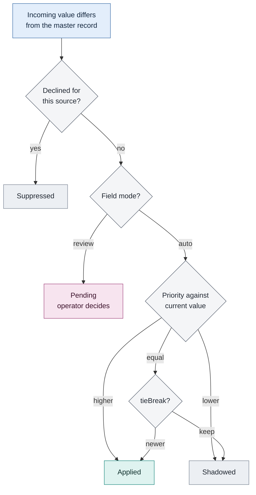

A sync rule records what the organisation trusts each source to say. This page covers the decisions in a rule and how to choose each one. [Create and edit rules](/docs/prism/usage/manage-rules) gives the procedure for writing the rule.

## The shape of a rule

A sync rule maps one connected dataset into the consolidated dataset. Write one rule for each source.

```json
{
  "id": "edr-to-consolidated",
  "name": "Endpoint security to consolidated assets",
  "sourceDataset": "crowdstrike.prod",
  "targetDataset": "consolidated-assets",
  "targetSchema": "AssetComputer",
  "enabled": true,
  "sourceIdField": "id",
  "identityKeys": { "hostname": "hostname", "mac": "network.0.macAddress" },
  "newAssetMode": "review",
  "reconcilePresence": true,
  "fieldRules": [
    { "sourceField": "osVersion", "targetField": "osVersion", "mode": "auto", "priority": 90 },
    { "sourceField": "extendedData.crowdstrikePreventionPolicy", "targetField": "preventionPolicy", "mode": "review", "priority": 95 }
  ],
  "createdAt": "2026-01-01T00:00:00Z",
  "updatedAt": "2026-01-01T00:00:00Z"
}
```

Each decision below sets one or more of these fields.

## Decide which source owns each field

Each field rule carries a priority from 0 to 100. When two sources disagree on a field, the higher priority wins.

Set priority per field, not per source. A source is strong on some fields and weak on others. An endpoint agent knows the operating system version better than any person does. A person knows the owner better than any agent does.

Draw a matrix before you write the rules. One row for each field, one column for each source:

| Field | Endpoint security | Cloud platform | CMDB | Spreadsheet | Why |
|---|---|---|---|---|---|
| Operating system version | 90 | 80 | 40 | 30 | An agent reads it from the running host. |
| Network address | 80 | 85 | 40 | 30 | The cloud platform assigns it. |
| Owner | none | 50 | 80 | 60 | A person sets it, and the CMDB is where people record it. |
| Location | none | 70 | 60 | 75 | The spreadsheet team audits racks by hand. |

Two habits keep the matrix workable:

- Leave gaps between the numbers. A source that you add later then fits between two existing ones without a change to any other rule.
- Give no two sources the same priority on one field, unless you also choose a tie-break. Equal priorities keep the existing value by default. Set `tieBreak` to `newer` to let the newer value win instead.

## Decide which changes need a person

Each field rule has a mode.

| Mode | What happens to a change | Choose it for |
|---|---|---|
| `auto` | The engine applies it at once, if its priority permits | Technical facts that a trusted source reads directly, such as an operating system version or an agent status |
| `review` | It waits for an operator, whatever its priority | Values with consequences: owner, criticality, security policy, and any field that a reverse rule writes back to another system |

A change in `review` mode reaches a person even when its priority is lower than the value it would replace. The operator sees both priorities and decides. An approval overrides priority.

Begin a new source with more fields in `review` than you expect to keep there. Move a field to `auto` once the review queue shows that the source is reliable for it.

## Decide whether a source can create assets

A source record that matches no master record is a new asset. `newAssetMode` decides what happens to it.

| Value | Effect | Choose it for |
|---|---|---|
| `review` | The default. An operator approves the new asset, links it to an existing master, or rejects it. | Every source, until you trust its identity keys |
| `auto` | The engine creates the master record at once | A source that is the authoritative register of the assets it reports |

A wrong identity mapping in an `auto` source creates a duplicate master for every record it fails to match. In `review`, the same mistake creates a queue of new-asset proposals, which an operator can see and stop.

## Decide how the source is matched

`identityKeys` names the source fields that hold the natural keys: a serial number, a MAC address and a host name. `sourceIdField` names the field that holds the source's own identifier. The engine stores that identifier against the master record as a cross-reference.

Map the strongest key that the source carries. The engine decides a match on the highest-ranked key that both records hold. A source that maps only a host name can therefore match only on host name. A host name match is weak, and the engine uses it only when no serial number or MAC address match exists.

Two sources that share no key type cannot be matched to each other at all. Check the matrix: every source must share at least one key type with the source that created the master records.

## Decide whether the source is a full inventory

`reconcilePresence` tells the engine whether the source reports every asset in its scope.

| Value | Effect | Choose it for |
|---|---|---|
| `true` | The default. An asset that the source reported before and does not report now produces a presence change. | A source that sees everything in its scope, such as a cloud account or a directory |
| `false` | The engine does not read absence as a signal | A partial or enrichment feed, such as a spreadsheet that covers one site |

A full-inventory source can still fail. If a collection returns almost nothing, every asset would look decommissioned. `presenceGuard` sets a limit: when more than `maxDropRatio` of the previously present assets vanish in one run, the engine skips presence reconciliation for that run. The guard applies only when at least `minAssets` assets were present. The defaults are 0.5 and 10.

## Decide how long a missing source keeps its say

When the source that owns a field stops reporting the asset, its value keeps its priority for a grace period. After the grace period, a value from any source that still reports the asset can replace it.

`stalenessWindowMs` sets the grace period in milliseconds. The default is 24 hours. Set it longer than the interval between two collections from that source. A spreadsheet that the team saves once a week needs more than a week. With a shorter grace period, its values lose their priority whenever it is a day late.

## Decide how a value is chosen

The flowchart combines the decisions above. It shows what happens to one incoming value that differs from the master record.



## Sending values back to a source

A reverse rule maps fields from the consolidated dataset to a source system. Its target is the source, so the engine queues write-backs instead of merging.

```json
{
  "id": "consolidated-to-cmdb",
  "name": "Push consolidated host names to the CMDB",
  "masterDataset": "consolidated-assets",
  "targetSource": "jira-assets.prod",
  "enabled": true,
  "fields": [
    { "masterField": "hostname", "sourceField": "summary" }
  ],
  "mirror": {
    "mode": "review",
    "createFields": { "project": { "key": "ASSET" }, "issuetype": { "name": "Computer" } }
  }
}
```

Two choices matter here:

- **Which fields to send.** Send the fields where the consolidated dataset is more accurate than the target. Leave out the fields that the target owns. In the matrix above, the CMDB owns the owner field, so a reverse rule to the CMDB does not send it.
- **Whether to create records.** A master record can be missing from the target. `mirror` lets the rule propose a new record in the target for it. `createFields` holds the fixed values that every new record needs, such as a project and a record type. Keep the mode at `review`, so an operator approves each new record before the connector creates it.

[Run a write-back](/docs/prism/usage/write-back) covers the two halves of the operation, and what the shipped drain command does and does not write.
