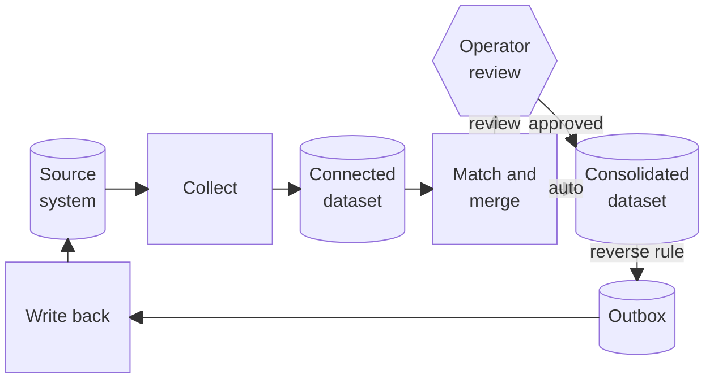
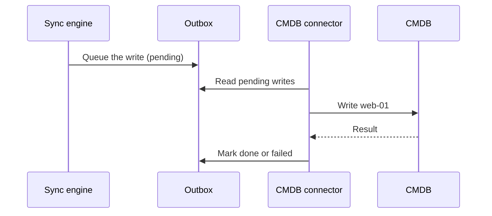
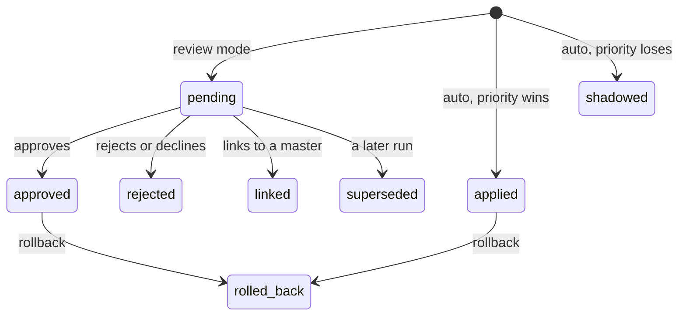

Sightline Prism runs a cycle. It collects from each source, matches the records that describe one asset, and merges their fields. It puts the consequential changes in front of a person, and it sends corrections back to the sources. This page follows one server through that cycle.

## The Terms

| Term | Meaning |
|---|---|
| connector | The code that reads one type of source, such as CrowdStrike or a spreadsheet |
| connector manifest | One configured instance of a connector: which system, which credentials and which schema |
| snapshot | The records that one collection from one source produced, stored unchanged |
| connected dataset | The snapshots from one source. The sync engine reads it and never edits it. |
| sync rule | The mapping from one connected dataset into the consolidated dataset, with a mode and a priority on each field |
| changeset | The changes that one run of a rule proposes, each with its outcome |
| consolidated dataset | The merged result. It holds one master record for each asset. |
| reverse rule | A rule whose target is a source system. It queues write-backs instead of merging. |
| outbox | The queue of write-backs for one source, which the connector at that source drains |

## The Cycle

*Figure 1. The Prism cycle, from a source system back to the same source.*

Collection and write-back run near each source, because only those machines can reach it. Matching, merging and review run centrally. [Deployment options](/docs/prism/architecture/deployment-options) describes how the two halves map onto machines.

## Follow One Server

The example uses two sources: a spreadsheet that a team keeps, and the CrowdStrike endpoint security platform. The rule settings are examples for this page, and every value is invented.

### 1. Collect

Each collector reads its source, normalises every record to a Prism schema, validates it, and stores a snapshot in that source's connected dataset.

| Field | Spreadsheet record | CrowdStrike record |
|---|---|---|
| Host name | `web01` | `web-01` |
| MAC address | `00:00:5E:00:53:01` | `00-00-5e-00-53-01` |
| Operating system version | `20.04` | `22.04` |
| Location | `Rack 4` | none |
| Owner | `Platform team` | none |
| Prevention policy | none | `standard` |

The spreadsheet arrived first. An operator approved it as a new asset, so a master record already exists with the spreadsheet's values.

### 2. Match

The sync engine must decide whether the CrowdStrike record describes the same server as the master record. It compares natural keys in rank order: serial number, then MAC address, then host name. The highest-ranked key that both records carry decides the match.

Neither record has a serial number. Both have a MAC address, and the two values normalise to the same twelve characters, so the records match. The host names differ, but the engine does not consult them, because a higher-ranked key already decided.

The engine also stores CrowdStrike's own device identifier against the master record. The next collection from CrowdStrike matches on that cross-reference directly.

### 3. Merge

For each mapped field, the engine compares the incoming value with the value that the master record holds. An identical value produces no change. A different value produces a proposed change, and the field's mode and priority decide what happens to it.

| Field | Master holds | Incoming | Mode | Outcome |
|---|---|---|---|---|
| Host name | `web01`, spreadsheet, priority 50 | `web-01`, priority 85 | `auto` | Applied, because 85 is higher than 50 |
| Operating system version | `20.04`, spreadsheet, priority 50 | `22.04`, priority 90 | `auto` | Applied |
| Prevention policy | nothing | `standard`, priority 95 | `review` | Pending, for an operator |

Location and owner do not change, because CrowdStrike does not report them. The master record keeps the spreadsheet's values for those fields.

### 4. Review

The operator opens the pending changes in the review TUI or the review app. Each row shows the old value, the new value, the source and its priority. The operator approves the prevention policy, then confirms, and the engine writes it to the master record.

An operator has four answers to a pending change:

| Answer | Effect |
|---|---|
| Approve | The value is written. An approval overrides priority. |
| Reject | The value is not written. The source can propose it again on the next run. |
| Decline | The value is not written, and that exact value from that source is suppressed from then on. |
| Decline the field | The value is not written, and that source is never proposed for that field again. |

[Review and apply changesets](/docs/prism/usage/review-changesets) gives the procedure.

### 5. Record

The master record now holds the merged view. Each field carries its evidence.

| Field | Value | Source | Priority |
|---|---|---|---|
| Host name | `web-01` | CrowdStrike | 85 |
| Operating system version | `22.04` | CrowdStrike | 90 |
| Location | `Rack 4` | Spreadsheet | 50 |
| Owner | `Platform team` | Spreadsheet | 55 |
| Prevention policy | `standard` | CrowdStrike | 95 |

Each field also records the time it changed and the changeset that changed it.

### 6. Spreadsheet Reload

A week later the team saves the spreadsheet again, still with the host name `web01`. The sync proposes `web01` at priority 50 against `web-01` at priority 85. The engine records the change as shadowed and leaves the master record unchanged.

A shadowed change is not an error. The changeset keeps it with a reason that names the stronger source and both priorities. An operator can see from it that the spreadsheet is out of date.

### 7. Write Back

The CMDB still calls the server `web01`. A reverse rule maps fields from the consolidated dataset to the CMDB. When it runs, the engine queues a write-back for the host name in the CMDB's outbox.

*Figure 2. Example: the sync engine queues the write of web-01, and the CMDB connector performs it.*

The engine holds no connection to the CMDB and no credentials for it. The connector near the CMDB performs the write. A queued write stays pending until that connector reports a result. [Run a write-back](/docs/prism/usage/write-back) gives the procedure.

## Behaviour Across Repeated Collections

Prism repeats the cycle on each collection. Three behaviours keep the consolidated dataset honest between collections.

- **Cross-references.** Once a source record is matched, later collections from that source match on the source's own identifier. A renamed host stays attached to its master record.
- **Staleness.** A source can stop reporting an asset. Its values then keep their priority for a grace period, 24 hours by default. After that, a value from any source that still reports the asset can replace them.
- **Presence.** The engine tracks which sources still report each asset. An asset that its sources stop reporting becomes a decommission candidate, and it reactivates if a source reports it again.

Every proposed change ends in one of these states:

*Figure 3. The outcomes a proposed change can reach.*

[Sync engine](/docs/prism/architecture/sync-engine) states each rule exactly. [Designing sync rules](/docs/prism/methodology/designing-rules) covers the choices that set the priorities and modes in this example.
