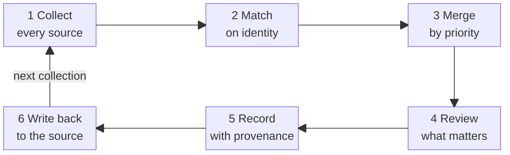

The methodology pages explain the problem Sightline Prism solves, the model it uses, and the decisions an operator makes when writing rules. The architecture pages explain how each part works, and the usage pages give the procedures.

## Pages

| Page | Question it answers |
|---|---|
| [The asset data problem](/docs/prism/methodology/asset-data-problem) | Why does no single system hold an accurate asset inventory, and what does a fix need? |
| [How Prism works](/docs/prism/methodology/how-prism-works) | What happens to an asset record between its source and the consolidated dataset? |
| [Designing sync rules](/docs/prism/methodology/designing-rules) | Which source speaks for which field, which changes need a person, and when is an asset missing? |

## The Method in Short

1. Collect from every system that knows about an asset, and change none of them during collection. Each source keeps its own connected dataset.
2. Match records on identity, not on name. A serial number outranks a MAC address, and a MAC address outranks a host name.
3. Give each field an owner. A priority on each field of each sync rule states which source the organisation trusts for that value.
4. Let the engine apply the routine changes. Put a person in front of new assets and of any value that is expensive to get wrong.
5. Keep the evidence. Every merged value records its source, its priority and the time it changed.
6. Send corrections back to the source systems through a write-back, so the tools that people use every day agree with the consolidated dataset.

*Figure 1. The reconciliation cycle, which repeats on every collection.*
